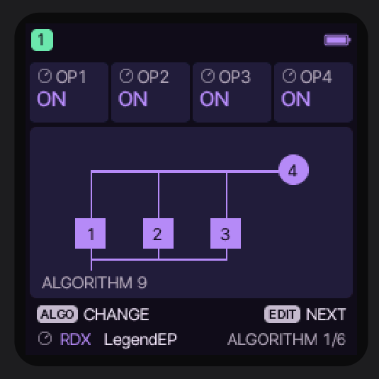

# Felucca RDX for M-VAVE FM-1

[](https://github.com/easyhard007/Felucca-RDX/actions/workflows/pages.yml)

**Author:** [easyhard007](https://github.com/easyhard007)

Felucca RDX is dedicated firmware that turns the M-VAVE FM-1 into an
eight-voice, four-operator synthesizer inspired by the Yamaha reface DX. It is
a modified fork of [Felucca](https://github.com/hugelton/Felucca) by Leo
Kuroshita / Hügelton Instruments. The product UI exposes only the RDX
instrument and its sound sets.



The current firmware version is **Felucca RDX 1.1.1**. Its version-encoded FM-1
firmware identity is **`FM-1_96510101`** (`965 + M + mm + pp`). RDX is monotimbral: the
runtime contains one track and one eight-voice RDX part. The old four-track
Felucca mixer, extra MIDI-track channels and automatic track selection are not
part of the RDX build.

Current features include:

- 12 four-operator FM algorithms and an optimized fixed-point renderer;
- Yamaha reface DX envelopes, Pitch EG, LFO, keyboard scaling, mono/legato and
  portamento behaviour;
- Factory and Selected sound sets, including imported reface DX SysEx voices;
- dual-core voice rendering with detailed timing and AUDIO LATE diagnostics;
- an `FX1 -> FX2` serial stereo effects chain;
- the Felucca full-rate Delay, a fixed-point stereo JIANT Chorus, and a
  Q14 stereo port of the Mutable Instruments Clouds reverb exposed as Hall;
- fixed-point PicoFaceDX Phaser-RDX and the tuned THK-W Flanger-RDX algorithm;
- five MIDI velocity curves with Q8.8 velocity inside the RDX engine;
- HOME controls for Reface `MODE` (`Poly`, `MonoFull`, `MonoLeg.`), `PORTA`
  (0–127), calibrated per-sound `GAIN` (−24…+24 dB), and `Trans.` (±24
  semitones), plus centred nonzero ±3-octave status shared by panel, MIDI,
  arpeggiator and sequencer notes.

The primary build output is `build/felucca.fwsc`. It can be loaded by the
[FM-1 emulator](https://joakimeriksson.github.io/fm1-emu/?fw=local&mhz=100)
or installed on an FM-1 through the generated local Web MIDI installer.
The build also produces `build/felucca-clean.fwsc`; this fresh-install package
erases saved projects, user voices and samples, autosave data and system settings.

The normal package is the single package intended for The FM-1 Firmware Hub.
It carries an RDX-owned storage marker: upgrades from an earlier Felucca-RDX
retain their user voices and settings, while a first install over another
Felucca-derived firmware atomically discards incompatible projects, autosave
and user-voice records. Panel calibration is retained. The clean package remains
available in the Felucca-RDX installer for an explicitly requested factory reset.

The Hub card metadata is kept in [`fmhub.json`](fmhub.json). Release tags use
the `rdx-vX.Y.Z` prefix because this fork retains upstream Felucca's historical
`vX.Y.Z` tags locally. Never publish all local tags with `git push --tags`.
Pushing an RDX tag builds, verifies, attests and publishes exactly one Hub
asset named `Felucca-RDX.fwsc`; the clean package is deliberately excluded.

The public GitHub Pages tools are built from `main` by GitHub Actions:

- [Felucca-RDX Installer](https://easyhard007.github.io/Felucca-RDX/webapp/installer/)
- [Felucca-RDX Editor](https://easyhard007.github.io/Felucca-RDX/webapp/editor/#library)
- [Felucca-RDX Online Emulator](https://easyhard007.github.io/Felucca-RDX/webapp/emulator/)
- [Felucca-RDX User Manual](https://easyhard007.github.io/Felucca-RDX/webapp/manual/)

The installer downloads the firmware package produced by the same workflow, so
the website and firmware always come from the same commit and version. The online
installer also has an **Install a local firmware file** section. It validates a
user-selected FM-1 `.fwsc` locally and can install older or third-party FM-1
packages without uploading the file; only trusted firmware should be used.
The online
emulator is rebuilt from the current RDX source on every deployment and therefore
opens the latest build automatically. It is intended for sound, SysEx, routing and
UI checks; it does not reproduce the FM-1's AC79 dual-core timing, USB or DMA.

See [GUIDE.md](GUIDE.md) for the build, simulator and installation workflow.

## Build

From PowerShell:

```powershell
git clone https://github.com/easyhard007/Felucca-RDX.git
cd Felucca-RDX
.\build-rdx.ps1
```

The default build enables both CPU cores. Use `-Cpu2 0` only when producing a
single-core diagnostic build.

The version is defined once in `firmware/src/rdx_version.h`. Release builds use
semantic versioning; the splash, WebAssembly page and installer package all use
that single value.

`.github/workflows/pages.yml` builds the dual-core RDX firmware, builds the
WebAssembly emulator, assembles the installer, editor, emulator and manual with
`web/make_site.py`, and deploys `build/site` to GitHub
Pages on every push to `main`. The workflow can also be run manually from the
repository's Actions page.

## Source and licences

The RDX patch format, envelopes, operator behaviour, frequency rules,
algorithms and parts of the effects implementation derive from
[RDX_new/PicoFaceDX](https://github.com/Michi71/PicoVintageSynthCollection/tree/main/instruments/PicoFaceDX)
by Michi71. They were rewritten and optimized as fixed-point C for the JieLi
AC79 platform. See [CREDITS.md](CREDITS.md) for contributor attribution and
[LICENSING.md](LICENSING.md) for the file-by-file licence details.

This repository retains parts of upstream Felucca that are still required for
file-format compatibility, build generation and regression tests. Legacy FM6
source filenames therefore do not imply that FM6 is exposed as a selectable
instrument in the RDX firmware.

Felucca RDX as a whole is distributed under GPL-3.0-only. Bundled and ported
components keep their compatible original licences.

M-VAVE, FM-1, Yamaha and reface DX are trademarks of their respective owners.
This independent community project is not affiliated with or endorsed by
Yamaha, M-VAVE, Hügelton Instruments or their respective owners.
